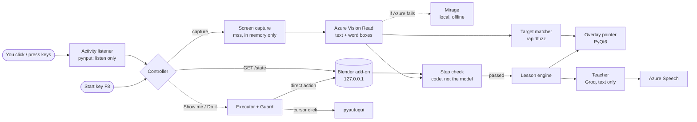

# Pathlit

**An AI teacher that sits next to your cursor in Blender.** It points at the next thing to click, speaks one short line, and checks that
you really did it before moving on. If you prefer, it can also click for you.

> Pathlit teaches Blender 4.1 on Windows. It was built as a course project (Microsoft AI-901 topics) under the working name *Shifu*.
> Status: working prototype. See [Project status](#project-status) for what is measured, and what is not yet.

---

## Contents
1. [What it does](#what-it-does)
2. [Three modes](#three-modes)
3. [How it works](#how-it-works)
4. [Quick start](#quick-start)
5. [Configuration](#configuration)
6. [Using Pathlit](#using-pathlit)
7. [Typed tasks ("build a house")](#typed-tasks-build-a-house)
8. [Show me and Do it: the safety model](#show-me-and-do-it-the-safety-model)
9. [Privacy](#privacy)
10. [Command reference](#command-reference)
11. [Testing and evaluation](#testing-and-evaluation)
12. [Project status](#project-status)
13. [Troubleshooting](#troubleshooting)
14. [Project layout](#project-layout)
15. [Design decisions](#design-decisions)
16. [Limitations](#limitations)
17. [Credits and licences](#credits-and-licences)

---

## What it does

Blender's screen is crowded and video tutorials cannot see where you are stuck. Chat assistants cannot see your screen at all.
Pathlit watches Blender only when you interact with it, and walks you through a task one small step at a time:

- **8 built-in lessons**, starting with "Model a donut" (9 steps), then edit mode, workspaces, sculpting, lights and cameras, duplicating, object properties and render settings.
- **It follows you.** Press the start key once, then just click in Blender. After each click Pathlit checks the step; if you did it, a pointer glides to the next target and a short line is spoken. If you are mid-step (a menu is open, a second click is still to come) it stays quiet.
- **It checks your work.** Screen text is read by Azure Vision, and a small Blender add-on reports the mode, objects, modifiers and each object's location, rotation and scale, so "Scale Z = 1.5" is verified, not assumed.
- **You can ask for your own task.** Type "add a monkey head and make it smooth" and Pathlit plans the steps, checks the plan, and teaches (or builds) it.
- **It can do the work.** *Show me* clicks each step while you watch. *Do it* finishes the whole task itself, under strict safety rules.

The pointer is a small cursor-shaped overlay that glides between targets with easing, pulses on arrival, and fades when you click what it
points at. The overlay and the control panel are excluded from screen capture, so their text is never read as part of Blender's screen.

## Three modes

| Mode | What Pathlit does | Default |
|---|---|---|
| **Teach me** | Points and speaks. You click. Pathlit never moves the mouse. | yes |
| **Show me** | Moves the real cursor to the target, waits for your OK (the start key), clicks, narrates. | no |
| **Do it** | Does the whole task with a countdown before every action. | no |

Switch modes with the buttons in the panel or the tray icon (blue = Teach me, amber = Show me, red = Do it). Show me and Do it start
only when **you** choose them and press the start key. Esc stops everything instantly. Details in
[the safety model](#show-me-and-do-it-the-safety-model).

## How it works



The idea that shapes everything: **the language model only writes words.** Code decides whether a step passed, and where the pointer
goes. The model never sees an image and never gives coordinates; a target is named by its on-screen text and found by the screen reader.

One cycle (a click in Blender, or the start key):

1. Capture the screen, read it with Azure Vision, and ask Blender for its state, all at once.
2. Run the check for the step shown last (screen text, Blender state, or "you clicked the target").
3. Pass: advance (or catch up if you ran ahead). Not yet: stay quiet, look once more a moment later, and nudge once if you stall.
4. Find the next target's text on screen and glide the pointer to it.
5. The teacher (Groq) writes one or two short sentences for this step; if it is unavailable, the lesson's own text is spoken.
6. Azure Speech reads the line aloud.

Measured on a saved screenshot with real Azure and Groq: the pointer is ready about **0.9 s** after a check starts, and the first spoken word
arrives at a median of about **2.2 s** (target: 3 s).

## Quick start

**You need:** Windows 10 (2004+) or 11, one monitor, Python 3.11 or newer (built on 3.14), Blender 4.1, a free
[Groq](https://console.groq.com) API key, and an Azure account with **Computer Vision** and **Speech** resources (the free F0 tiers are enough).

```
# in the project folder
pathlit setup        # first time: creates .env, then checks your Azure keys
pathlit blender      # installs the Blender add-on; then close Blender completely and reopen it
pathlit doctor       # is everything ready?
pathlit              # start Pathlit
```

Type `pathlit` in the VS Code terminal (it activates the virtual environment for you), or `.\pathlit` in a plain PowerShell, or
double-click `pathlit.cmd`. The first run creates the Python environment and installs `requirements.txt` by itself.

Then: open Blender (Layout workspace, default scene), press **F8**, and do what the pointer shows.

### Manual install (if you prefer)

```
python -m venv .venv
.venv\Scripts\python -m pip install -r requirements.txt
copy .env.example .env      # fill in the values; never commit .env
.venv\Scripts\python scripts\install_addon.py --autoload
.venv\Scripts\python scripts\run.py
```

### Setting up Azure (about 15 minutes)

1. Create a resource group, then a **Computer Vision** resource and a **Speech** resource on the **Free F0** tier. Student subscriptions
   often allow only some regions (East Asia worked in development); the create form tells you if a region is blocked.
2. Copy each resource's endpoint, key and region into `.env`.
3. Get a free Groq key at console.groq.com and put it in `.env`.
4. Run `pathlit setup`, which makes one test call to each service.

> **Do not create Azure AI Search on a paid tier by mistake.** Its default tier costs hundreds of dollars a month. It is optional here
> (it only adds manual excerpts), and Pathlit runs fine without it.

## Configuration

`.env` (copy from `.env.example`; it is git-ignored):

| Key | Purpose |
|---|---|
| `AZURE_VISION_ENDPOINT`, `AZURE_VISION_KEY` | screen reading |
| `AZURE_SPEECH_KEY`, `AZURE_SPEECH_REGION` | the spoken voice |
| `GROQ_API_KEY`, `GROQ_MODEL`, `GROQ_MODEL_SMALL` | the teacher and the planner (`openai/gpt-oss-120b` and `-20b`) |
| `AZURE_SEARCH_*` | optional manual excerpts |
| `AZURE_OPENAI_*` | not used (see [Design decisions](#design-decisions)) |
| `DEBUG_SAVE_SCREENS` | keep `false`; screenshots are never written to disk otherwise |

`settings.yaml` (every value is commented in the file):

| Setting | Meaning |
|---|---|
| `hotkey`, `stop_key` | start / check key (`f8`; F9 is Blender's own) and the stop key (`esc`) |
| `mode` | `teach`, `show` or `do` at startup |
| `auto_advance`, `auto_window_title` | follow your clicks, but only when a window with this in its title has focus |
| `auto_settle_s`, `fast_settle_s`, `second_look_s`, `idle_hint_s` | timings of the auto-advance checks |
| `allowed_apps`, `action_delay_s`, `max_actions_per_task`, `mouse_move_s`, `mouse_abort_px` | Show me / Do it limits |
| `match_min`, `vision_max_edge`, `voice`, `provider`, `mirage_fallback` | matching threshold, image size sent to Azure, voice, model provider, local fallback |

## Using Pathlit

1. Start it. A small control panel opens and the terminal prints a status banner (lessons, Blender link, add-on version, teacher, auto-advance).
2. Press **F8** (or the panel button) to start the next lesson. Pathlit announces it and points at the first target.
3. Do the step. The pointer fades when you click it, then glides to the next one. Wrong click or an open menu? Silence, not scolding.
4. Stalled for about 20 seconds? It explains the step once. **F8** at any time means "check me now"; after two misses you get a hint.
5. The panel lists every step: ✓ done, ▶ current, ○ upcoming.

Lessons: *Model a donut*, *Switch between Object and Edit mode*, *Move between workspaces*, *Your first look at Sculpt mode*,
*Add a light and a camera*, *Duplicate and delete objects*, *Read the Object properties*, *Find the render settings*. They are plain JSON in
`lessons/blender/`, validated on load (a bad file is rejected with the name of the step), and each step has a target (by text), a spoken
line, and a check.

## Typed tasks ("build a house")

Type a goal in the panel and click **Plan steps**. Pathlit asks the model for a build plan, **checks it with code**, and queues it.

A plan is a list of parts, each with a shape and exact numbers:

```
Walls:  set Scale to X 2, Y 1.5, Z 1.25      set Location to X 0, Y 0, Z 1.25
Roof:   click Cone                           set Scale to X 2.5, Y 2.5, Z 0.75   set Location to X 0, Y 0, Z 3.25
Door:   click Cube                           set Scale to X 0.4, Y 0.06, Z 0.9   set Location to X 0, Y 1.56, Z 0.9
```

- The **code writes each instruction and each check from the numbers**, so the text you read, what Do it performs, and what is verified
  cannot disagree.
- The model is taught each shape's size and a stacking recipe (a roof's Location Z = top of the walls + its own half-height), and is told to
  use thin cubes, never planes, for doors and windows.
- A **geometry self-check** works out where every part ends up and flags parts that are below the ground, floating, mostly buried inside
  another part, a flat plane in mid-air, or hanging above a cone roof's sloping surface. If it finds a problem it shows the model its own
  geometry and asks for one correction.
- Menu items need their menu opened first; missing "Click Add / Click Mesh" steps are inserted automatically.
- Anything about scripts, Python or add-ons is dropped; non-Blender goals are refused politely. The plan assumes Blender's default scene.

The plans were rendered in a real Blender 4.1 during development to check them by eye (a roof buried in the walls, doors that were
invisible slivers, and a floating chimney were all found and fixed this way). Plans still vary from run to run, so treat the geometry warnings
shown in the panel as hints, not guarantees.

## Show me and Do it: the safety model

Cursor control is the most sensitive part of the project, so its rules are built into the code and tested (`tests/test_control.py`):

1. **You start it.** Nothing moves unless you chose Show me / Do it and pressed the start key.
2. **Esc always wins.** It stops movement and speech within a frame. Moving the real mouse more than 50 px during an action, or slamming it into a screen corner (`pyautogui`'s failsafe), also stops it.
3. **Allowed apps only.** The window in front must contain an entry from `allowed_apps` (default: Blender). If another window comes to the front, it stops.
4. **Warn before, check after.** A pointer and a countdown appear before every action; the step check runs after it; a failed check stops the task.
5. **No dangerous actions.** It will not click Save, Export, Delete, New, Open, Quit and similar unless the lesson step explicitly allows it. **It never types text or presses keys.**
6. **An allow-list for direct Blender actions:** add a primitive, switch mode, select an object, add a Subdivision / Bevel / Mirror modifier, set one named value, move / rotate / scale, set an exact location / rotation / scale, undo. Everything is validated in the app and **again inside the add-on**; nothing from a request is ever passed to `exec` or `eval`.
7. **A red border and banner** show whenever Pathlit is controlling your mouse.
8. **Everything is logged** to `logs/actions.csv`. At most 1 action per second and 40 per task.
9. **Text on the screen is data, never an instruction.** Only the lesson and your request decide what it does.
10. In **Teach me** mode the mouse-control library is not even imported.

Do it prefers a *direct* action inside Blender (for example "add a torus") over three menu clicks: it cannot miss a button. Show me uses
the cursor, except for steps a cursor cannot do (typing numbers), which it performs directly.

## Privacy

- Screenshots exist in memory for about a second and are **never saved** (unless you set `DEBUG_SAVE_SCREENS=true`).
- Pathlit looks at the screen **only after you interact**, only during a lesson, and only when a window with "Blender" in its title has focus.
- The screen is sent to Azure Vision for text reading (that is the one place an image leaves the computer). The model (Groq) gets **text only**: the step, a list of on-screen words and Blender's state. It never gets an image or coordinates.
- Keys live in `.env`, which is ignored by Git. `logs/` holds text and timings only and is ignored by Git.
- If anything fails (network, model, Blender link) the lesson carries on with its own text and screen-only checks.

## Command reference

| Command | What it does |
|---|---|
| `pathlit` | start Pathlit |
| `pathlit setup` | first-time setup: `.env`, then a test call to each Azure service |
| `pathlit doctor` | keys, Blender link, add-on version, is a copy already running |
| `pathlit stop` | close any running copy (only one can run at a time) |
| `pathlit blender` / `pathlit blender remove` | install / remove the Blender add-on |
| `pathlit shortcut` | put a Pathlit icon on your Desktop |
| `pathlit collect`, `label`, `eval`, `results` | the evaluation workflow |
| `pathlit test` / `pathlit test fast` | all tests / only the offline ones |
| `pathlit help` | the full list |

## Testing and evaluation

```
pathlit test fast      # about 260 offline tests, around 90 seconds
pathlit test           # also the live tests, which call Azure on real Blender screenshots (needs your keys)
```

Tests are named by requirement (`test_fr8_wrong_action_does_not_advance...`). No test moves a real mouse; cursor control is tested with fakes,
and the add-on's actions were also verified in a real Blender 4.1.

The Phase 3 evaluation (pointing accuracy for Mirage vs Azure Vision vs a router, step-check accuracy, a user test) has its tools built and
validated, but **its data has not been collected yet**:

```
pathlit collect     # 50 planned scenes; saves only the Blender window, plus the add-on's state
pathlit label       # drag a box round each target text (hand-drawn, so truth never comes from a reader)
pathlit eval        # runs everything and rebuilds docs/results.md (which says NOT RUN for anything missing)
```

The protocol for the classmate user test is in [`docs/user_test_sheet.md`](docs/user_test_sheet.md) and a presentation script is in
[`docs/demo_script.md`](docs/demo_script.md).

## Project status

**Working:** the 8 lessons, auto-advance, the step checks, the pointer overlay, the spoken lines, the Blender add-on (state and allow-listed actions),
typed-task planning with the geometry self-check, Show me (confirmed to move and click on a real machine), Do it (built and tested with fakes and the
add-on's actions verified in a real Blender), the tray and panel, the one-word launcher.

**Measured** (during development, on saved screenshots, real services):

| What | Result |
|---|---|
| Screen reading on 10 real Blender screens | Azure Vision found 94 to 128 text lines per screen; local Mirage found 11 to 30 and located only 2 of the 100 target-word checks (10 words x 10 screens), so Vision is the main reader |
| Pointer ready after a check starts | median ~0.9 s |
| First spoken word | median ~2.2 s (target 3 s) |
| Azure Vision upload | a 2048 px JPEG reads in about 0.9 s against about 1.7 s for the full-size image, with the same 16 of 16 test targets found |

**Not done yet:**
- The Phase 3 evaluation numbers and the user test (tools ready; see above).
- Do it end to end on a real run, the Esc / other-window / mouse-moved stops on a real run, and click accuracy at other display scalings.
- Undo (`ed.undo`) fails inside Blender's timer context; it is on the allow-list but not working, so there is no "undo everything" offer.
- A voice command to switch modes (needs speech-to-text).
- Azure AI Search (manual excerpts): the code, the index builder and the manual pages are written and tested with fakes only; no Search resource exists.

Every finding, decision, bug and open question is written down in [`docs/questions.md`](docs/questions.md) (65 numbered items).

## Troubleshooting

| Symptom | Cause and fix |
|---|---|
| `pathlit` is "not recognized" in PowerShell | PowerShell does not run programs from the current folder by name. Use the VS Code terminal (venv active), or type `.\pathlit` once; it then adds a short `pathlit` command to the venv. |
| "The Blender add-on is out of date" / HTTP 501 | Blender runs a **copy** of the add-on. Run `pathlit blender`, then close Blender completely and reopen it. Re-do this after any change under `blender_addon/`. |
| F9 does something in Blender | F9 is Blender's "Adjust Last Operation". The default start key is F8; change `hotkey` in `settings.yaml` if F8 clashes. |
| Two voices at once / a stuck pointer | Two copies of Pathlit are running. `pathlit stop`, then `pathlit`. A second copy now refuses to start. |
| Show me / Do it does nothing | Blender must be the window in front (Pathlit waits 10 s for you to click it). In Show me mode press the start key again as the OK. `logs/actions.csv` shows why a task stopped. |
| "The free model is busy" | Groq's free tier allows 8,000 tokens a minute for the planner model. Pathlit waits as long as Groq asks (up to 30 s) and retries once. |
| `.env` missing keys | `pathlit doctor` lists them (names only, never values). |
| The pointer lands on the wrong item | The same word can appear in several places. Pathlit prefers a standalone label, then the match nearest the previous target. Check `logs/session.csv` (`candidates` column). |

## Project layout

```
pathlit.cmd            launcher (creates the venv on first run)
settings.yaml          all tunable settings, commented
src/pathlit/
  cli.py main.py       the `pathlit` commands, and the application wiring
  controller.py        the cycle: capture, check, advance, point, speak, log; auto-advance triggers
  activity.py hotkeys.py   listen-only keyboard and mouse hooks
  capture.py           screenshots in memory, DPI handling
  perception/          azure_vision (primary), mirage_reader (local fallback), router, target_match
  lessons/             loader (pydantic), engine (the step loop), checks (code-decided pass/fail)
  brain/               teacher (Groq), planner + builder (typed tasks), vocabulary, docs_search, manual
  control/             actions (allow-list), guard (safety), mouse, executor (Show me / Do it)
  overlay/             the pointer and bubble (PyQt6), capture exclusion
  ui/                  control panel, labelling canvas
  voice.py             Azure Speech
  skillmap.py          SQLite skill map
  evaluation.py capture_plan.py   Phase 3 evaluation logic
blender_addon/         the Blender add-on (state, allow-listed actions) and its autoload script
lessons/blender/       the 8 lessons (JSON)
scripts/               run, install the add-on, spikes, evaluation, data collection, labelling
tests/                 about 260 offline tests plus live tests
docs/                  questions.md (findings and decisions), results.md, do_mode.md, demo script, user-test sheet
```

## Design decisions

- **The model writes words; code decides.** Step advancement depends only on code checks, and pointer positions only on the screen reader.
- **Azure Vision first, Mirage as the fallback.** The first plan was local-first, but on Blender screens Mirage found almost none of the UI text, so the order was reversed. Mirage keeps the app usable offline.
- **Groq instead of Azure OpenAI.** No Azure OpenAI model could be deployed on the student subscription in its allowed regions. The teacher is Groq (text only) behind an interface that also supports "none", where lessons use their own text.
- **One click per step.** Menu steps are split so every check is clean and the pointer can move between clicks.
- **Checks that cannot pass early.** A first-step screen check must not already be true on the untouched layout (this caught a real bug in lesson 5, where "Light" is also an object in the Outliner).
- **Nearest-to-the-last-target matching** and **standalone-label preference** fix the "same word in two places" problem (the Object menu vs the word in "Object Mode"; the Add menu's Camera vs the Camera object in the Outliner).
- **The Blender add-on re-validates everything.** The app checks every action, and the add-on checks it again, because it is the part that changes the scene.

## Limitations

- Windows only, one monitor, English only, Blender 4.1 menus (the lessons and the label lists are for 4.1).
- Pointing needs the target to have **text**; icons (like the Modifiers wrench) are described but not pointed at.
- Typed-task plans vary between runs and depend on the model's arithmetic. They assume the default scene, and cones are round.
- The free tiers have limits: Azure Vision allows 20 calls a minute, Groq 8,000 tokens a minute on the planner model.
- A single-user prototype. No accounts, no storage of anything about the learner.

## Credits and licences

- Blender manual excerpts (an optional index; the manual pages are downloaded locally and are **not** in this repository): Blender Documentation Team, CC BY-SA 4.0.
- [Mirage](https://cactuscompute.com) (local text reader): Cactus Compute, Apache 2.0. Azure Vision, Speech and Search: Microsoft. Teacher and planner model: Groq (`openai/gpt-oss`).
- PyQt6, pynput, pyautogui, mss, rapidfuzz, pydantic, pandas, matplotlib and the other packages in `requirements.txt` keep their own licences.
- **Project licence: not chosen yet.** Until a `LICENSE` file is added, all rights are reserved by the author.
